# CS5351 SE Meeting Report

## 1st Online Meeting

Topic: Discussion of project functional requirements, basic framework, and task allocation

Meeting time: 2025-09-12 22:00  

End time: 2025-09-12 23:00

### Meeting Materials

Function descriptions, reference GitHub links and tech stacks:

1. **Analyse GitHub repository contributions (number of commits, lines of code, timeline) and automatically generate a web report**
   - **Function description**: The goal of this feature is to analyse the contribution status of a GitHub repository (such as number of commits, lines of code, timelines, etc.) and generate an automated web report.
   - **Reference project**: [RepoSense](https://github.com/reposense/RepoSense)
   - **Tech stack**: Java + Spring Boot backend, Vue frontend

2. **Fetch repository data via GitHub API and generate dashboards (PR, commits, issues, activity)**
   - **Function description**: Use the GitHub API to obtain repository data (such as Pull Requests, commit history, issue activities, etc.) and generate dynamic dashboards to help the team monitor project progress and member activity.
   - **Reference project**: [Git Insights](https://github.com/git-insights/git-insights)
   - **Tech stack**: Node.js + React

3. **Facilitate management and monitoring of the development process**
   - **Function description**: Provide management and monitoring tools to help the development team efficiently manage the development process, centrally display development tasks and progress, and improve team collaboration and transparency.
   - **Reference project**: [eladmin](https://github.com/elunez/eladmin)
   - **Tech stack**: Vue, Spring Boot, MyBatis

4. **Streamlit is an open-source framework for building data apps in Python and quickly creating beautiful data visualisation apps**
   - **Function description**: The Streamlit framework helps to quickly build interactive data applications and use Python for data presentation.
   - **Reference project**: [Streamlit](https://github.com/streamlit/streamlit)
   - **Tech stack**: Python, suitable for data visualisation

5. **Draggable card-based task management (similar to the game in tutorial 1), where cards label task content, assignee, execution time, etc.**
   - **Function description**: A draggable card-style task management system, where tasks are represented by cards containing task content, responsible person, and execution time information.
   - **Reference project**: [young-datafan-ooooo1](https://github.com/young-datafan-ooooo1)
   - **Tech stack**: Java + Vue

6. **Automated CI/CD pipeline for build and deployment**
   - **Function description**: Establish an automated Continuous Integration and Continuous Deployment (CI/CD) pipeline to improve development efficiency and deployment quality.
   - **Reference project**: [Jenkins](https://github.com/jenkinsci/jenkins)
   - **Tech stack**: Jenkins, Docker, Kubernetes

7. **Code quality and coverage analysis tools**
   - **Function description**: Automatically analyse code quality and provide coverage reports to help the development team improve code quality.
   - **Reference project**: [SonarQube](https://github.com/SonarSource/sonarqube)
   - **Tech stack**: Java, Jenkins, Docker

8. **Automated testing framework integration (UI and unit tests)**
   - **Function description**: Build an automated testing framework and integrate UI and unit tests to ensure code quality and stability.
   - **Reference project**: [Selenium](https://github.com/SeleniumHQ/selenium)
   - **Tech stack**: Java, Selenium, TestNG

9. **Customised log management and data analysis platform**
   - **Function description**: Provide a custom log management and data analysis platform to help the team with log monitoring, error detection, and performance analysis.
   - **Reference project**: [ELK Stack](https://github.com/elastic/elasticsearch)
   - **Tech stack**: Elasticsearch, Logstash, Kibana (ELK)

### Meeting Conclusions

Main feature: CI/CD

Alternative goals: Project management + task allocation + progress monitoring

Tasks:

1. Find a tech stack to replace Docker  
2. Define the specific functions of the website, two functions per person, including function overview and expected effect  
3. Deadline: Sunday night, 2025-09-13

## 2nd Offline Meeting

Topic: Discussion of project functional requirements, basic framework, and task allocation

Meeting time: 2025-09-15 19:00  

End time: 2025-09-15 21:00

Location: HA 1006

### Meeting Materials

[actions/starter-workflows: Accelerating new GitHub Actions workflows](https://github.com/actions/starter-workflows)

### Meeting Conclusions

Tech stack decisions:

- Java + MyBatis  
- GitHub Actions

Tasks:

1. By 2025-09-22 (week 4 Monday)

   - Frontend: Understand how GitHub Actions work internally  
   - Backend: Find open-source projects that integrate GitHub Actions with a Java + MyBatis frontend/back-end stack  
   - Backend: Familiarise with MyBatis framework and Java development

2. By 2025-09-29 (week 5 Monday)

   - Frontend: Successfully run a GitHub Action  
   - Backend: Basic database setup and Action interfaces  

   Deliverable: Complete a working demo for running Actions.

## 3rd Meeting

Topic: Discussion of week 2 task progress and next-stage tasks

Meeting time: 2025-09-22 19:00  

End time: 2025-09-22 21:30

Location: Y5-505

Participants:

2 online, 4 onsite, 1 absent

- Online: Boyu Zhang, Xuanming Liu  
- Onsite: Junlan Zheng, Zihan Lin, Zeyu Li, Siqi Li

### Meeting Materials

Project management open-source project: [Taiga.io](https://github.com/taigaio)

CI/CD frontend page reference: Jenkins

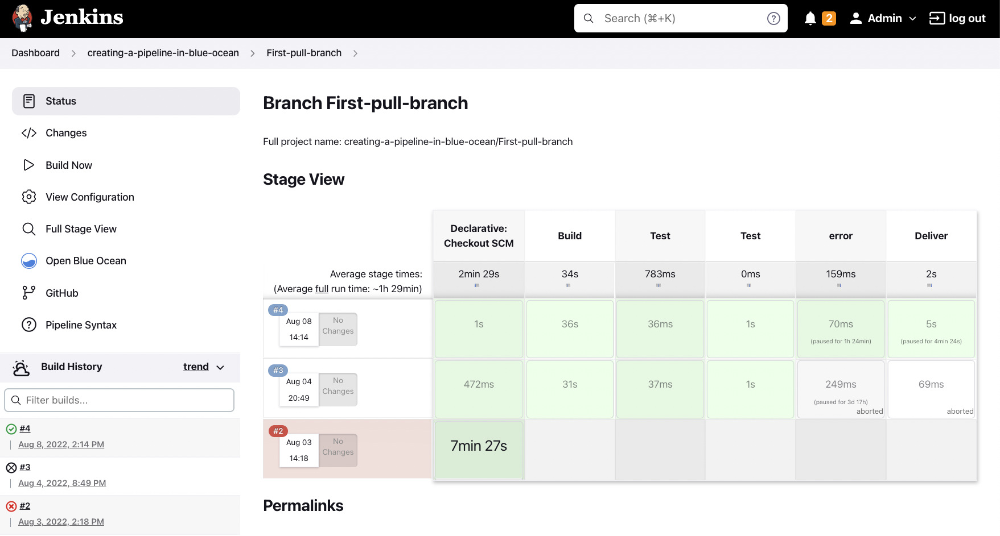

CI/CD backend setup: GitHub Actions

### Meeting Conclusions

Framework decision: Use the Taiga project as the main framework.

Tech stack: Python + PostgreSQL

Planned project features:

- CI/CD  
- GitHub status checking (synchronisation)  
- Card-based event/status management  
- Data visualisation  
- Burndown chart  
- Chatbot  

Tasks for this stage:

1. Local deployment of the Taiga project  
2. GitHub status checking (periodic automatic updates via timer)  
3. CI/CD backend API integration  
4. CI/CD workflow visualisation page  

Next meeting time: Expected Friday, 2025-09-26

## 4th Online Meeting

Topic: Each member reports on project deployment status and function testing, and discuss web features

Meeting time: 2025-09-28 22:00  

End time: 2025-09-29 01:00

### Meeting Materials

Project configuration manual: [Taiga: Setup development environment](https://docs.taiga.io/setup-development.html#_before_starting)

### Meeting Conclusions

All members completed basic project deployment: virtual machine, Ubuntu, PostgreSQL.

Current tasks: Familiarise with project code and GitHub Actions documentation.

Task allocation:

| Task                                 | Member                 |
| ------------------------------------ | ---------------------- |
| GitHub repository setup              | Zihan Lin              |
| VM environment configuration, images | Zeyu Li                |
| Familiarise with GitHub Actions docs | Boyu Zhang, Zihan Lin  |
| Familiarise with Taiga events        | Junlan Zheng, Siqi Sun |
| Familiarise with database schema     | Siqi Li                |

Next meeting time: Expected Tuesday, 2025-09-30

## 5th Online Meeting

Topic: Discuss project status, task progress, and assign new tasks

Meeting time: 2025-09-30 19:00  

End time: 2025-09-30 21:00

### Meeting Materials

[Taiga REST API](https://docs.taiga.io/api.html#importers-github)

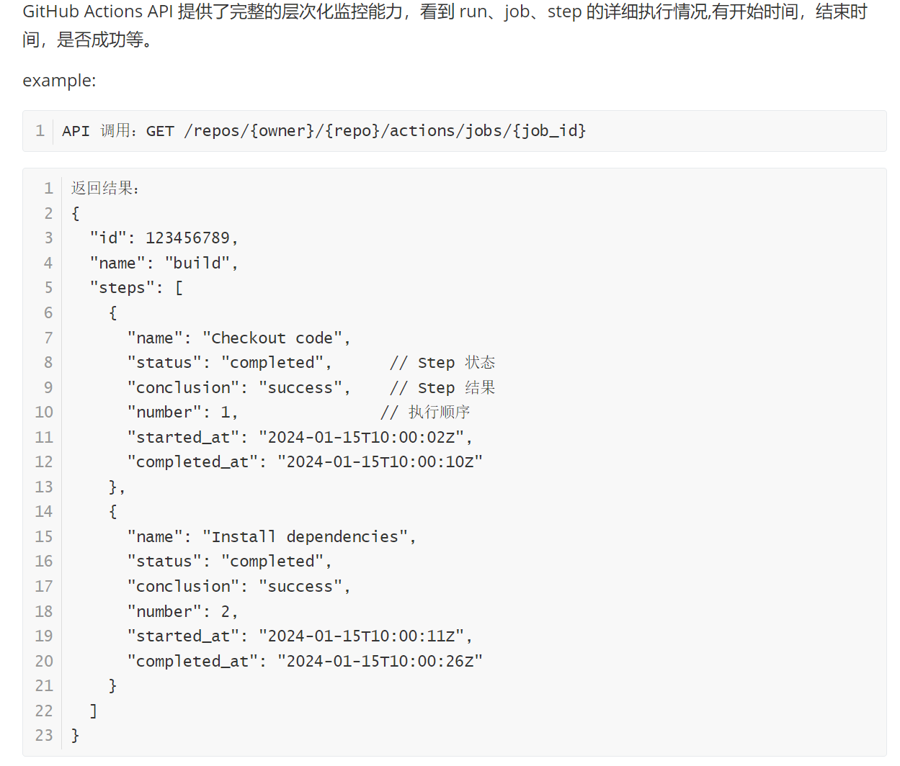

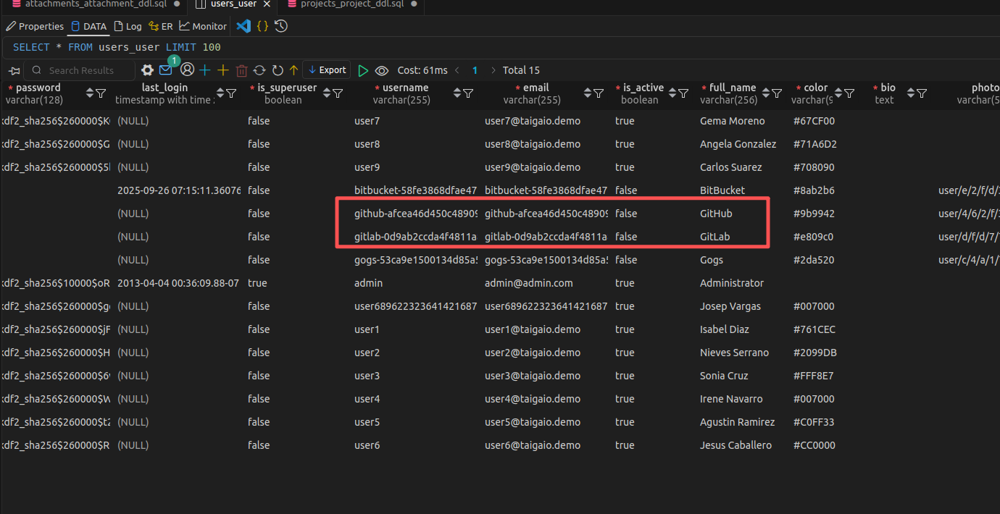

### Meeting Conclusions

- Taiga event configuration failed and is temporarily shelved.  
- Between Taiga and GitHub, auth-based login and one-time project import are already available, but update/synchronisation functionality is missing.

Tasks:

- Backend:

  - Allow users to upload Action configuration files and dynamically display the required sections.  
  - Use the API to retrieve the number and content of jobs in a workflow, as well as execution time and success/failure status.

- Frontend:

  1. Debug the progress bar:

     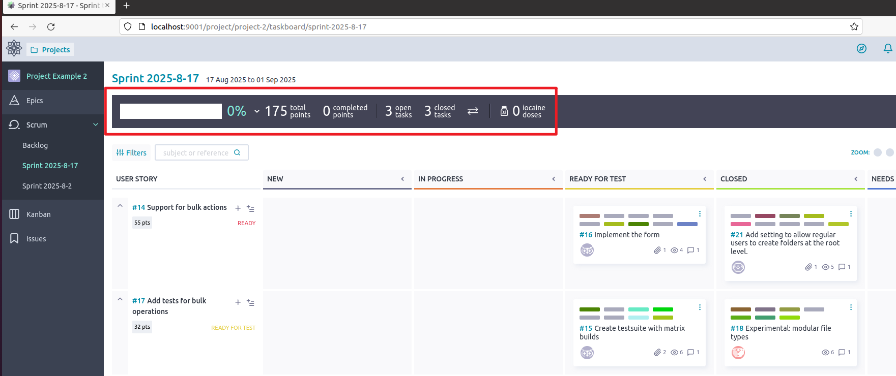

  2. CI/CD visualisation:

     Adapt to the user’s Action file.

     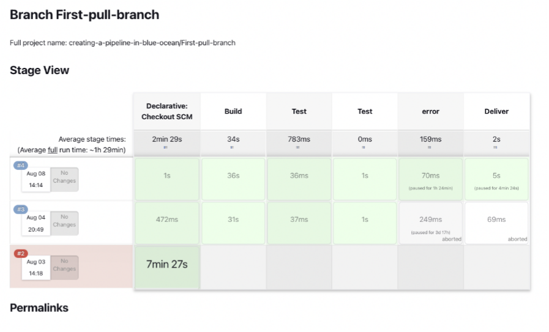

Next meeting time: Expected Sunday, 2025-10-05

## 6th Offline Meeting

Topic: Discuss project status, task progress, and conduct frontend–backend pair programming

Meeting time: 2025-10-20 19:00  

End time: 2025-10-20 21:00

### Meeting Content

- Backend completed a demo of web-based reading of GitHub workflow data.  
- GitHub integration work in progress.  
- Frontend modified the web page structure.  
- Refactored website structure and adjusted key features.  
- UI design discussions.

### Meeting Conclusions

Tasks:

- Backend:

  - Implement the GitHub login module.  
  - Change GitHub Actions execution from asynchronous to synchronous (dynamic progress bar).  
  - Synchronise progress, steps, and status.  
  - Implement workflow retrieval and upload.

- Frontend:

  - Fix bug: Scrum user story points.  
  - Fix bug: GitHub has import only but no synchronisation.  
  - Implement CI/CD visualisation.

- CI/CD workflow:

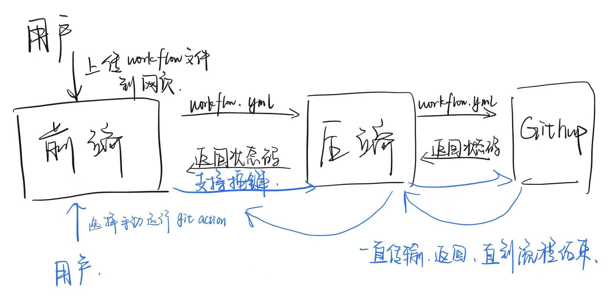

- Paper writing.

## 7th Offline Meeting

Topic: Synchronise task progress and discuss bugs

Meeting time: 2025-10-29 19:00  

End time: 2025-10-29 21:00

### Meeting Content

- Backend completed GitHub auth login for the website and designed the CI/CD workflow pipeline.  
- Frontend had no progress.

### Meeting Conclusions

Tasks:

- Backend:

  - Fix the bug where the GitHub account login page freezes and cannot return to the website.

- Frontend:

  - Implement the CI/CD visualisation page.  
  - Fix bugs in the user story module.

- Paper:

  First complete the first three chapters:

  1. Intro()

     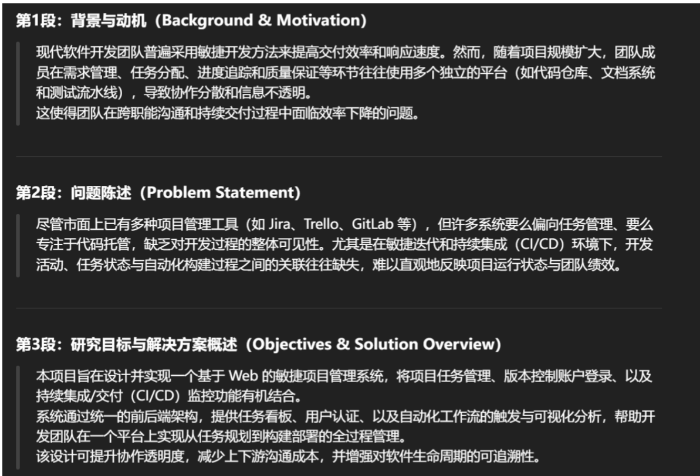

  2. Related work (Xuanming Liu)

     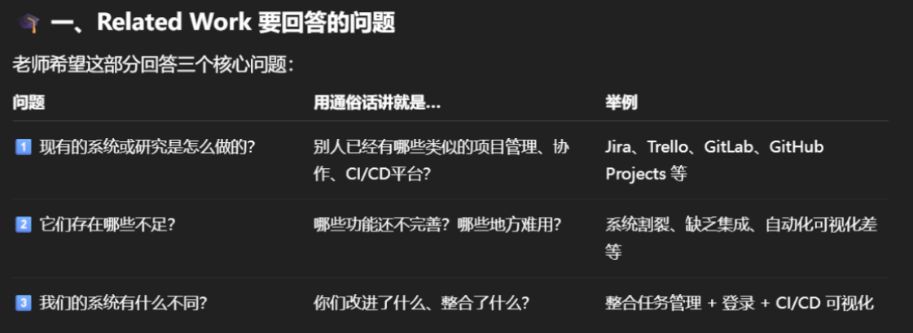

  3. Preliminaries

     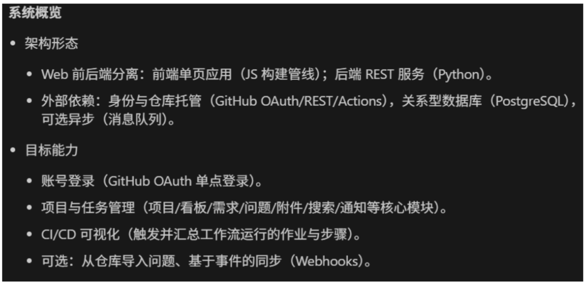

     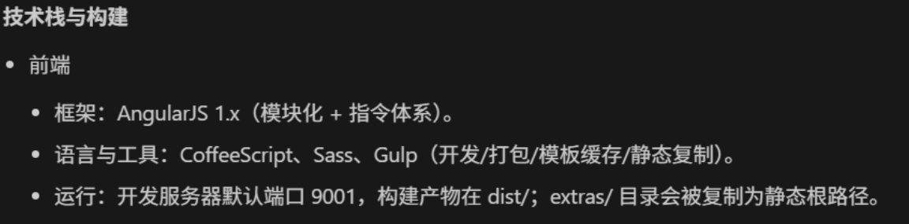

     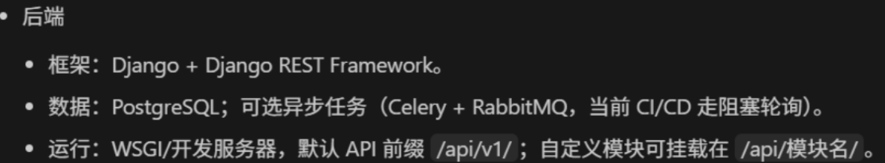

     Boyu Zhang:

     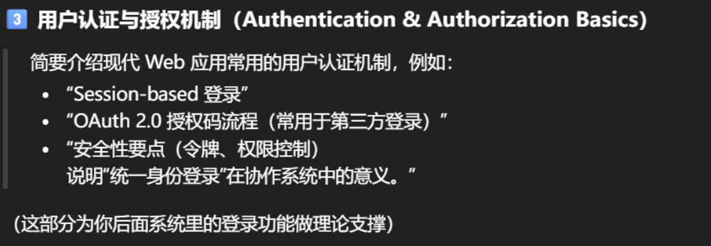

     Zeyu Li:

     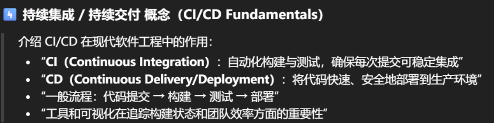
